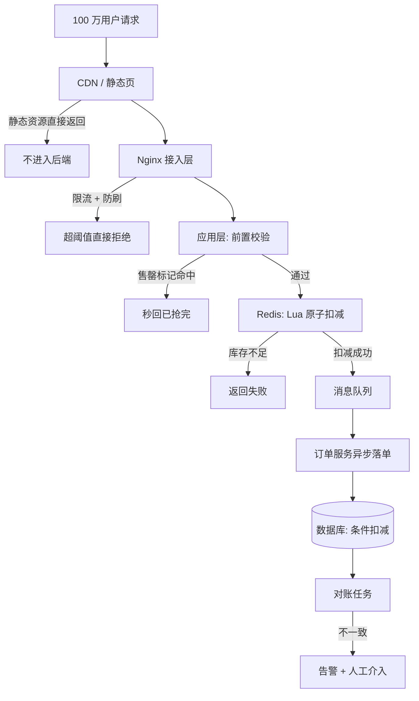
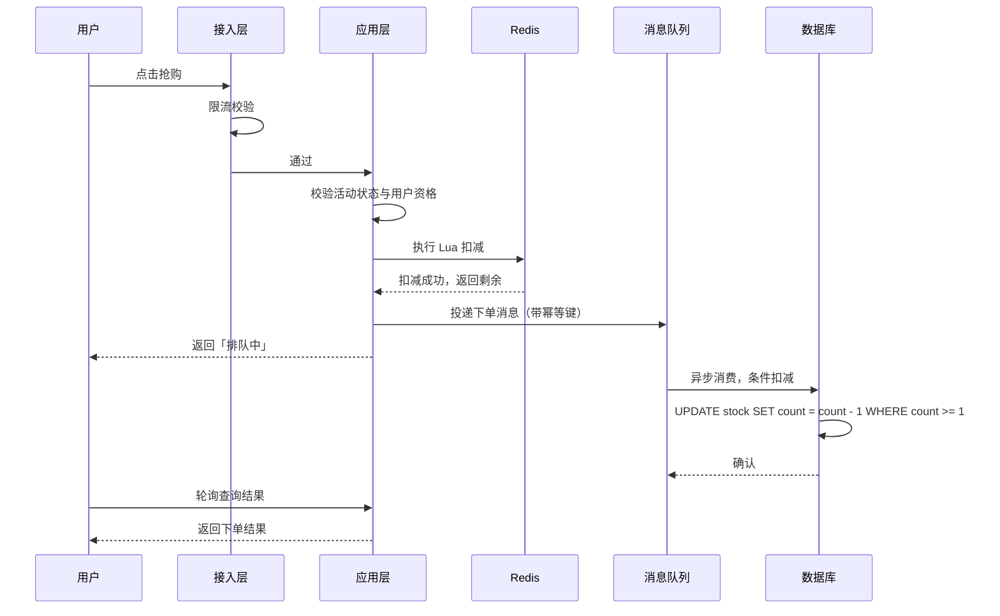

# 秒杀与库存扣减

> 这是场景题里的「Hello World」——**人人都会讲架构，但很少有人能讲清量级和故障**。本文按 [答题框架](README.md) 的六步走一遍，重点放在数字推导和兜底设计上。

返回 [场景设计题首页](README.md) · [面试首页](../README.md)。

## ① 澄清需求

面试时**不要直接开始画架构**。先问这几个问题，问完再动手：

| 要问的 | 示例回答 | 为什么重要 |
| --- | --- | --- |
| 参与人数和时长？ | 100 万人参与，10 秒内打进来 | 决定峰值 QPS |
| 库存多少？ | 1000 件 | 决定「拒绝率」，从而决定设计重心 |
| 能否超卖？ | 绝对不能，少卖可以接受 | 决定一致性强度 |
| 是否允许重复下单？ | 每人限购 1 件 | 决定幂等键的设计 |
| 下单后多久要看到结果？ | 允许异步，3 秒内出结果 | 决定能否用消息队列削峰 |

**关键判断**：库存 1000、参与 100 万，意味着 **99.9% 的请求注定失败**。所以整个设计的核心不是「如何服务 100 万请求」，而是**「如何用最低成本快速拒绝 99.9% 的请求」**。这句话讲出来，面试官就知道你抓住重点了。

## ② 容量估算

| 指标 | 推导 | 结果 |
| --- | --- | --- |
| 峰值 QPS | 100 万 ÷ 10 秒 | 10 万 QPS |
| 有效请求 | 库存 1000 件 | 最多 1000 次成功 |
| 需拒绝请求 | 100 万 − 1000 | 约 99.9 万 |
| 应用层机器数 | 10 万 ÷ 单机 2000 QPS | 约 50 台（若无前置拦截） |

**结论**：50 台机器只为了服务 1000 个有效请求，显然不合理。**所以必须在最外层就把无效流量拦掉**，让真正到达应用层的请求量级降到千级。

## ③ 分层设计



| 层 | 职责 | 关键设计 |
| --- | --- | --- |
| CDN / 静态页 | 挡掉不需要后端的流量 | 商品详情静态化，库存数字由前端异步拉取 |
| 接入层 | 限流、防刷 | 按 IP / 用户 / 设备限流，超出直接返回 |
| 应用层 | 参数校验、活动校验、快速失败 | 读本地「售罄标记」，命中则直接短路 |
| Redis | 承接所有库存判断 | 库存预热到 Redis，用 Lua 保证「判断+扣减」原子 |
| 消息队列 | 削峰、解耦 | 只把扣减成功的请求投递进去，量级已降到千级 |
| 数据库 | 最终落库 | 条件更新作为最后一道防线 |
| 对账 | 兜底 | 定时比对 Redis 与 DB 的扣减记录 |

### 为什么库存判断要放在 Redis

一个 Lua 脚本同时完成「读库存 → 判断 → 扣减」，天然原子：

```lua
-- KEYS[1]: 库存 key
-- ARGV[1]: 本次扣减数量
local stock = tonumber(redis.call('GET', KEYS[1]))
if stock == nil or stock < tonumber(ARGV[1]) then
    return -1
end
redis.call('DECRBY', KEYS[1], ARGV[1])
return stock - tonumber(ARGV[1])
```

**为什么不能用「GET 后再 DECRBY」两步**：两个命令之间可能被其他请求插入，导致超卖。Lua 脚本在 Redis 中单线程执行，中间不会被打断。

## ④ 关键流程



**正常路径的三个要点**：

1. **Redis 是唯一入口闸门**，所有库存判断都经过它；
2. **数据库不参与实时判断**，只做异步落库，用条件更新兜底；
3. **前端返回「排队中」而不是最终结果**，用轮询或推送拿结果，避免长连接占用。

## ⑤ 故障与兜底

这是场景题的**真正加分项**。逐个问自己「它挂了会怎样」：

| 故障 | 表现 | 兜底方案 |
| --- | --- | --- |
| Redis 挂了 | 所有请求穿透到数据库 | 入口限流把流量压到数据库能承受；数据库条件更新保证不超卖，但吞吐骤降 |
| Redis 与 DB 数据不一致 | 少卖或超卖 | 定时对账，以 DB 的实际扣减为准回写 Redis |
| 消息队列积压 | 用户长时间看不到结果 | 限流消费端、加消费者、超时降级为「稍后查询」 |
| 异步下单失败 | Redis 扣了库存但订单没生成 | 消费失败重试 + 死信队列 + 定时补偿 |
| 对账发现不一致 | 无法自动判定 | 告警 + 人工介入通道，**不做自动「修正」以免放大错误** |
| 用户重复提交 | 一人多单 | 幂等键（用户 ID + 商品 ID）+ 唯一索引 |

**必须主动说的一句**：「Redis 只是第一道闸，数据库的条件更新是最后一道防线。如果只靠 Redis，Redis 一挂或者数据丢了就直接超卖。」

## ⑥ 权衡取舍

| 选择 | 收益 | 代价 |
| --- | --- | --- |
| Redis 预扣库存 | 吞吐高，DB 压力小 | 需要额外的对账机制 |
| 异步下单 | 削峰，用户等待时间可控 | 用户体验从「同步」变成「异步」 |
| 数据库条件更新兜底 | 不超卖 | 极端流量下会大量失败，影响少量正常订单 |
| 每人限购 1 件 | 降低并发冲突 | 需要额外的用户维度去重 |

## 常见追问

**Q：超卖和少卖哪个更严重？**
看业务。实物商品超卖要赔付、要道歉，更严重；虚拟券超卖可能导致资损。所以**默认选择「宁少卖不超卖」**，用条件更新保证不超卖，少卖的部分靠对账补。

**Q：为什么不直接用数据库的行锁扣库存？**
`SELECT ... FOR UPDATE` 会把行锁住，并发量一上来锁等待时间剧增，吞吐可能只有几百 TPS。**行锁保护的是数据正确性，不是高吞吐**，两者要分开解决。

**Q：库存预热是什么时机做的？**
活动开始前由定时任务或运营后台触发，把库存写入 Redis。要注意**预热失败的重试**和**热重载**——活动开始后才发现没预热，就来不及了。

**Q：怎么防止刷子？**
按用户和 IP 限流、加验证码、设备指纹、行为特征识别。**关键是承认无法完全防住**，所以每一层都要有限流，而不是依赖单一手段。

**Q：如果峰值到了 100 万 QPS 呢？**
先把能挡的都挡掉（静态化、CDN、拒绝率），剩下的才是应用层的真实压力。如果还是不行，需要**分片**——把库存拆成 N 份放不同实例，请求按用户哈希落到分片，分摊 Redis 单点压力。

## 相关文章

- [CAS 与原子类](../../03-并发编程/02-深度解析/CAS与原子类.md)：无锁原子操作的原理
- [ThreadPoolExecutor 线程池](../../03-并发编程/02-深度解析/ThreadPoolExecutor线程池.md)：异步消费的线程模型
- [ConcurrentHashMap 并发容器](../../03-并发编程/02-深度解析/ConcurrentHashMap并发容器.md)：本地缓存与并发计数
- [缓存一致性与幂等](缓存一致性与幂等.md)
- [场景设计题答题框架](README.md)
