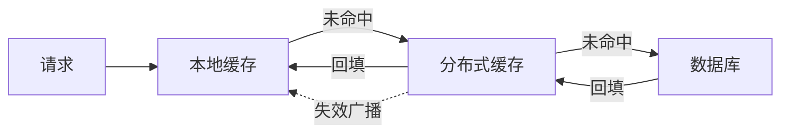

# 缓存一致性与幂等

> 两个高频且容易答浅的问题放在一起：**前者考「数据对不对」，后者考「操作重不重」**。这两个问题的共同点是——面试官会追着问「你的方案有什么问题」。

返回 [场景设计题首页](README.md) · [面试首页](../README.md)。

## 第一部分：缓存与数据库一致性

### ① 澄清需求

| 要问的 | 为什么重要 |
| --- | --- |
| 允许最终一致吗？窗口多久？ | 决定能否用异步方案 |
| 读多写少的比例？ | 决定是缓存优先还是直读 |
| 缓存的数据能不能重算？ | 能重算就可以直接删缓存，不需要更新 |
| 不一致时业务能不能容忍？ | 决定兜底强度 |

**最关键的一条**：**如果缓存数据可以从数据库重算出来，那就不需要「更新缓存」，只需要「删除缓存」**。这一条能省掉大量一致性问题。

### ② 容量估算

| 指标 | 推导 | 说明 |
| --- | --- | --- |
| 缓存命中率目标 | 通常 90% 以上 | 低于 80% 说明缓存设计有问题 |
| 缓存容量 | 热数据量 × 单条大小 × 冗余系数 | 只缓存热数据，不是全量数据 |
| 回源 QPS | 总 QPS × (1 − 命中率) | 这是数据库实际承受的读压力 |

**说法示例**：「10 万 QPS 的读请求，命中率 95% 的话，回源只有 5000 QPS，数据库完全扛得住。所以缓存的核心指标是命中率，不是容量。」

### ③ 分层设计



| 层 | 特点 | 代价 |
| --- | --- | --- |
| 本地缓存 | 纳秒级，扛热点 | 多实例间可能不一致，需要失效广播 |
| 分布式缓存 | 毫秒级，容量大 | 网络开销，需要处理热点 key |
| 数据库 | 强一致，容量最大 | 慢，压力敏感 |

### ④ 关键流程：四种更新策略对比

| 策略 | 流程 | 问题 | 结论 |
| --- | --- | --- | --- |
| 先更新 DB，再更新缓存 | DB → Cache | 并发下两个写请求的更新顺序可能反了，缓存留下旧值 | **不推荐** |
| 先删缓存，再更新 DB | Cache → DB | 删除后、更新前有读请求，会把旧值读回来写进缓存 | **不推荐** |
| 先更新 DB，再删缓存 | DB → Cache | 仍有极小概率不一致，但概率最低 | **推荐（Cache Aside）** |
| 订阅 binlog 更新缓存 | DB → binlog → Cache | 有延迟，但顺序由 DB 保证 | 适合对顺序敏感的场景 |

**为什么推荐「先更新 DB 再删缓存」**：出问题的窗口只有「更新 DB 成功」到「删除缓存成功」之间的极短时间，而且只有在这段时间内有读请求才会不一致。相比其他方案，这个窗口最小。

**「删除」而不是「更新」的理由**：如果并发更新，两个请求的「更新缓存」顺序可能与「更新 DB」的顺序相反，缓存会长期留存旧值。而删除是幂等的——无论删几次结果都一样。

### ⑤ 故障与兜底

| 问题 | 表现 | 方案 |
| --- | --- | --- |
| 缓存穿透 | 查不存在的数据，每次都打到 DB | 缓存空值（短过期）+ 布隆过滤器前置 |
| 缓存击穿 | 热点 key 失效瞬间大量请求回源 | 互斥锁重建 + 热点 key 不过期 |
| 缓存雪崩 | 大量 key 同时失效 | 过期时间加随机扰动 + 多级缓存 |
| 删除缓存失败 | 长期不一致 | 重试 + 消息补偿 + 过期时间兜底（最终一致） |
| 主从延迟导致读到旧值 | 删缓存后读从库仍是旧值 | 关键读走主库，或延迟一段时间再删一次 |

**三个概念的最简区分**：

| 概念 | 数据是否存在 | 影响范围 | 触发时机 |
| --- | --- | --- | --- |
| 穿透 | **不存在** | 单个 key，但可被攻击放大 | 持续 |
| 击穿 | 存在 | **单个热点 key** | 失效瞬间 |
| 雪崩 | 存在 | **大量 key** | 同时失效 |

### ⑥ 权衡取舍

| 方案 | 一致性强度 | 复杂度 | 适用 |
| --- | --- | --- | --- |
| Cache Aside + 过期兜底 | 最终一致 | 低 | 绝大多数场景 |
| 延迟双删 | 最终一致（更强） | 中 | 一致性要求较高的读多写少场景 |
| 订阅 binlog | 最终一致（有序） | 高 | 多级缓存、跨系统同步 |
| 读写都走 DB（不用缓存） | 强一致 | 低 | 写入频繁、对性能要求不高的场景 |

## 第二部分：接口幂等

### 为什么需要幂等

网络超时、用户重复点击、消息重投、定时任务重跑——**同一个请求被执行多次，是常态而不是异常**。

### 三种主流方案对比

| 方案 | 实现 | 适用 | 局限 |
| --- | --- | --- | --- |
| 唯一索引 | 业务唯一键加唯一索引，冲突即视为重复 | 创建类接口（下单、支付） | 只适用插入，不适用更新 |
| 状态机条件更新 | `UPDATE ... WHERE status = '待支付'`，看影响行数 | 状态流转类（订单、审批） | 需要业务有明确状态 |
| 去重表 / Token | 先占位再处理，带过期时间 | 通用，尤其非插入类 | 多一次存储读写 |

### 关键区别：并发重复 vs 延迟重复

这是最容易答漏的一点：

| 重复类型 | 表现 | 有效的方案 |
| --- | --- | --- |
| 并发重复 | 两个请求几乎同时到达 | 加锁能解决，唯一索引也能解决 |
| 延迟重复 | 第一次处理后很久，请求又来了 | **加锁无效**（锁早已释放），必须靠状态或去重记录 |

**所以面试时要说**：「加锁只能解决并发场景。如果是延迟重试，必须把幂等性编码进业务状态或持久化记录里，不依赖时序。」

### 代码示例：状态机条件更新

```java
/**
 * 幂等的订单状态流转：只有从「待支付」才能流转到「已支付」。
 * 重复调用时影响行数为 0，说明已经被处理过。
 */
public boolean markPaid(long orderId) {
    String sql = "UPDATE orders SET status = 'PAID', paid_time = ? "
            + "WHERE id = ? AND status = 'PENDING'";
    int affected = jdbcTemplate.update(sql, new Timestamp(System.currentTimeMillis()), orderId);
    return affected > 0;
}

/**
 * 幂等的创建：靠唯一索引拦截重复。
 * 捕获唯一键冲突后，返回已存在的那条记录，而不是报错。
 */
public long createOrder(String requestId, long userId, long skuId) {
    try {
        return orderRepository.insert(requestId, userId, skuId);
    } catch (DuplicateKeyException e) {
        Order existing = orderRepository.findByRequestId(requestId);
        return existing.getId();          // 幂等返回，让调用方拿到相同结果
    }
}
```

### ⑥ 权衡

| 选择 | 收益 | 代价 |
| --- | --- | --- |
| 唯一索引 | 简单可靠，DB 层保证 | 需要在业务上找到天然唯一键 |
| 状态机 | 语义清晰，不需要额外存储 | 依赖业务有状态模型 |
| 去重表 | 通用 | 多一次写入，需要考虑清理 |
| 全局锁 | 实现简单 | 性能差，且不解决延迟重复 |

## 常见追问

**Q：为什么「先删缓存再更新 DB」不可靠？**
删除后、DB 更新前，一个读请求会发现缓存未命中，于是读 DB 拿到**旧值**并写回缓存。之后 DB 才完成更新，缓存里留的却是旧值，而且没有过期时间的话会一直错下去。

**Q：延迟双删为什么还要延迟？**
第一次删除是为了让旧值尽快失效，延迟一段时间后再删一次，是为了清掉「删缓存后、更新 DB 前」被读请求回填的旧值。延迟时间要大于一次主从同步和一次读请求的耗时。

**Q：缓存能不能不设过期时间？**
不建议。**过期时间是最后的兜底机制**——它保证了即使所有主动失效逻辑都失败，数据最终也会自愈。兜底是有价值的，别为了「更高命中率」去掉它。

**Q：幂等键应该怎么设计？**
用**业务语义上的唯一标识**，而不是随机 UUID。比如「用户 ID + 商品 ID + 活动 ID」比一个随机请求号更有意义，因为它天然表达了「这个用户在这个活动里的这一次操作」。

**Q：消息消费的幂等和接口幂等一样吗？**
原理一样，但消息场景要额外处理**顺序**和**重投**。常见做法是把消息 ID 和业务 ID 一起作为幂等键，消费成功后记录到去重表，重投时直接跳过并确认。

## 相关文章

- [HashMap 原理与源码分析](../../02-集合框架/02-深度解析/HashMap原理与源码分析.md)：本地容器的并发边界
- [ConcurrentHashMap 并发容器](../../03-并发编程/02-深度解析/ConcurrentHashMap并发容器.md)：本地缓存的并发实现
- [CAS 与原子类](../../03-并发编程/02-深度解析/CAS与原子类.md)：乐观更新与重试
- [秒杀与库存扣减](秒杀与库存扣减.md)
- [场景设计题答题框架](README.md)
